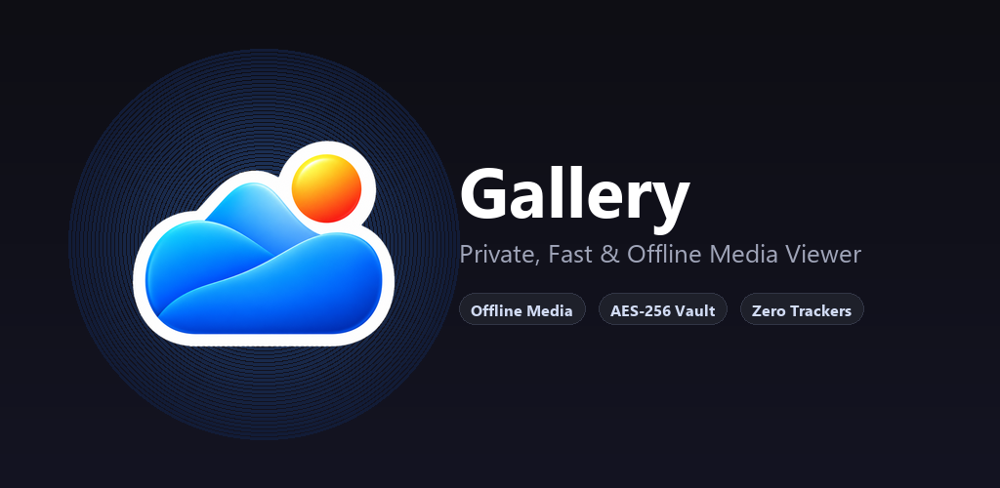

  

<h1 align="center">
  
   
  Gallery: Simple & Private
</h1>

  <strong>Your fast, clean, and 100% offline photo and video gallery for Android.</strong>

  
  
  
  
  

  <a href="#about-the-app">About</a> •
  <a href="#key-features">Features</a> •
  <a href="#privacy--security">Privacy & Security</a> •
  <a href="PRIVACY_POLICY.md">Privacy Policy</a> •
  <a href="#developer--contact">Developer</a>

---

  

---

## 📱 About the App

**Gallery: Simple & Private** is crafted to give you a pure, distraction-free photo and video experience. Built from the ground up to respect your digital privacy, Gallery operates **100% locally on your device** without cloud sync, analytics, or background telemetry.

Whether you want to browse memories, organize photo albums, view high-framerate videos, or securely hide private media behind biometric encryption, Gallery does it all smoothly with modern Android Material You design.

---

## ✨ Key Features

- 🛡️ **100% Offline & Private**  
  The app has zero network permissions (`android.permission.INTERNET` is explicitly removed). It is technically impossible for the app to upload or share your photos.

- 🔐 **Secure Encrypted Vault**  
  Safely encrypt and hide private photos and videos using industry-standard **AES-256 GCM** encryption. Vaulted items are completely isolated from system indexing, external apps, and file managers, unlocked only with your fingerprint or PIN.

- 🎬 **Dedicated Videos Album**  
  Quickly find, preview, and play all your recorded and saved videos from one dedicated card in the Albums tab.

- 🗑️ **Built-in Recycle Bin**  
  Safely recover photos or videos deleted by accident before they are permanently removed.

- 🎨 **Dynamic Material You Theme**  
  Adapts seamlessly to your system colors, supporting sleek Dark Mode, vibrant Light Mode, and OLED deep black themes.

- ⚡ **Lightweight & Blazing Fast**  
  High-performance smooth scrolling, pinch-to-zoom gestures, and instant EXIF metadata inspection with zero lag.

- 🚫 **Completely Ad-Free**  
  No banner ads, no interstitial popups, and no paid subscriptions. Just your photos and videos.

---

## 🔒 Privacy & Security

We believe your memories belong exclusively to you. Gallery adheres to strict privacy principles:

| Principle | Guarantee |
| :--- | :--- |
| **Zero Internet Access** | The app cannot communicate with any remote server. |
| **No Analytics or Trackers** | Contains no Google Analytics, Firebase, Crashlytics, or third-party tracking SDKs. |
| **No Advertising ID** | Does not collect or access advertising identifiers (`AD_ID`). |
| **Isolated Vault Storage** | Encrypted media is held in isolated private sandbox storage. |

For detailed information, please read our [Privacy Policy](PRIVACY_POLICY.md) or visit our [Online Privacy Policy](https://kaifazad.github.io/Gallery/).

---

## 👨‍💻 Developer & Contact

Developed with ❤️ by **Kaif Azad**

- **Developer:** Kaif Azad
- **Email:** [itzkaifazad@gmail.com](mailto:itzkaifazad@gmail.com)
- **Instagram:** [@kaif.azad](https://instagram.com/kaif.azad)
- **Google Play:** [com.kaifazad.gallery](https://play.google.com/store/apps/details?id=com.kaifazad.gallery)

---

  © 2026 Kaif Azad · Released under the Apache 2.0 License

